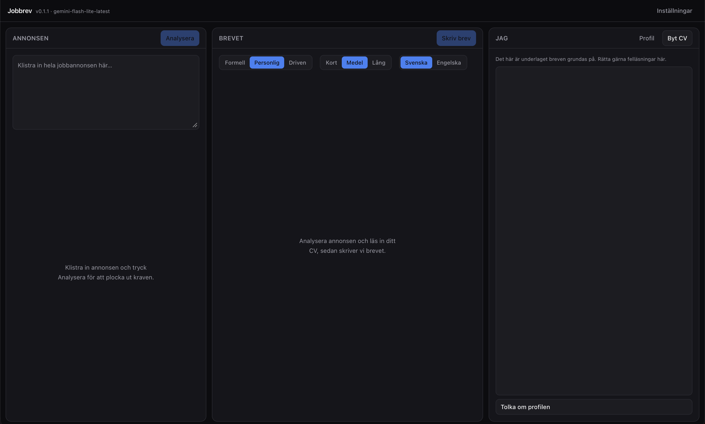

# Jobbrev

Skrivbordsapp för macOS och Windows som skriver personliga brev grundade i
ditt faktiska CV.

Klistra in jobbannonsen, läs in ditt CV en gång, och appen plockar ut kraven,
matchar dem mot CV:t och skriver två brevförslag som du kan redigera, förfina
och exportera.



## Stack

Tauri 2 · React 19 · TypeScript · Vite · Tailwind 4 · Google Gemini
(`@google/genai`). Ingen server, ingen databas — allt körs lokalt.

## Kom igång

```bash
npm install
cp .env.example .env    # lägg in din Gemini-nyckel i VITE_GEMINI_API_KEY
npm run tauri dev
```

Nyckeln hämtas i [Google AI Studio](https://aistudio.google.com/apikey).
`.env` är gitignorerad.

Appen letar efter nyckeln i den här ordningen:

1. `VITE_GEMINI_API_KEY` i `.env`
2. Systemets nyckelvalv (tjänsten `jobbrev`), som du fyller i via Inställningar
   — macOS Nyckelhanterare respektive Windows Credential Manager

Releasebyggen i GitHub Actions får aldrig nyckeln — repot är publikt, och Vite
hade bakat in den i klartext i en fil som vem som helst kan ladda ner och läsa.
Den nedladdade appen frågar i stället efter nyckeln vid start och sparar den i
datorns nyckelvalv, en gång per dator.

Att veta om `.env`: Vite bakar in värdet i frontend-bundlen vid bygget, så
nyckeln följer med in i `Jobbrev.app`. Det är rimligt för en app som bara du
kör på din egen maskin. Vill du hellre att nyckeln aldrig lämnar
Nyckelhanteraren — lämna `VITE_GEMINI_API_KEY` tom och spara nyckeln i
Inställningar i stället.

Bygg en app att dubbelklicka på:

```bash
npm run tauri build
# → src-tauri/target/release/bundle/macos/Jobbrev.app
```

## Släppa en ny version

```bash
npm run release -- patch    # 0.1.0 → 0.1.1
npm run release -- minor    # 0.1.0 → 0.2.0
npm run release -- major    # 0.1.0 → 1.0.0
npm run release -- 1.4.0    # exakt version
```

Versionen bor på fem ställen (`package.json`, `package-lock.json`,
`tauri.conf.json`, `Cargo.toml`, `Cargo.lock`) och måste vara densamma överallt
— annars får `.dmg`:n ett annat nummer än taggen. Skriptet skriver alla fem,
typkontrollerar, committar, taggar `vX.Y.Z` och pushar.

Resten gör `.github/workflows/release.yml`: taggen triggar ett bygge per
plattform och lägger båda i samma release.

| Plattform | Fil | Runner |
|---|---|---|
| macOS (Apple Silicon) | `Jobbrev_X.Y.Z_aarch64.dmg` | `macos-latest` |
| Windows (x64) | `Jobbrev_X.Y.Z_x64-setup.exe` | `windows-latest` |

Bygget sker alltså aldrig på din maskin, utan från exakt det som ligger i repot
— och Windows-versionen behöver ingen Windows-maskin. Faller den ena
plattformen publiceras ingen release alls, hellre det än ett halvt släpp.

Skriptet kräver ett rent arbetsträd och att du står på `main` — taggen ska peka
på exakt det som byggs. Faller typkontrollen läggs versionsfilerna tillbaka, så
det blir aldrig ett halvt släpp.

| Flagga | Gör |
|---|---|
| `--dry-run` | visar vad som skulle hända, ändrar ingenting |
| `--any-branch` | tillåter release från en annan gren än `main` |

Versionen måste vara rent numerisk (`1.4.0`, inte `1.4.0-beta.1`) eftersom
macOS bygger `CFBundleShortVersionString` av den.

Ingen av filerna är signerade, så båda operativsystemen bromsar dem första
gången. På macOS:

```bash
xattr -dr com.apple.quarantine /Applications/Jobbrev.app
```

Eller utan terminal: försök öppna appen, och klicka sedan **Öppna ändå** under
Systeminställningar → Integritet och säkerhet. En app du byggt lokalt är aldrig
karantänsatt — flaggan kommer från nedladdningen.

På Windows visar SmartScreen *"Windows protected your PC"*. Klicka **More
info → Run anyway**.

## Så fungerar det

1. **Annonsen** analyseras till strukturerade fakta: krav, meriterande,
   ansvar, deadline, kontaktperson, nyckelord.
2. **CV:t** läses in från PDF, Word (.docx) eller text och struktureras.
   PDF:er skickas till Gemini som fil, eftersom modellen läser kolumnlayout
   bättre än en lokal textextraktion gör.
3. **Matchningen** går igenom krav för krav och sätter `matchad`, `delvis`
   eller `saknas` — med ett ordagrant citat ur CV:t som belägg.
4. **Brevet** skrivs med matchningen som underlag, med en hård regel i prompten
   att ingenting får påstås som inte går att härleda ur CV:t. Krav du inte
   uppfyller formuleras som lärvilja, aldrig som påhittad erfarenhet.

Två varianter genereras: *Meriterna först* och *Motivationen först*. Samma
fakta, olika upplägg.

## Språk

Appen går på svenska eller engelska. Välj under **Inställningar → Språk i appen**;
valet sparas i `settings.json` och gäller gränssnittet, felmeddelandena, filnamnen
vid export och matchningens kommentarer. Citaten ur CV:t lämnas alltid ordagranna.

Brevets språk är en egen sak och väljs i brevpanelen — du kan alltså köra appen på
svenska och skriva brevet på engelska.

## Var saker sparas

| Vad | Var |
|---|---|
| API-nyckel | `.env`, eller macOS Nyckelhanterare (`jobbrev` / `gemini-api-key`) |
| CV-profil | `~/Library/Application Support/com.jonaslarsson.jobbrev/cv/profile.json` |
| Inställningar | samma mapp, `settings.json` |
| Brev | dit du väljer att spara dem |

## Granska alltid brevet

Språkmodeller glider. Läs igenom brevet och kontrollera att varje påstående
finns i ditt CV innan du skickar det.
